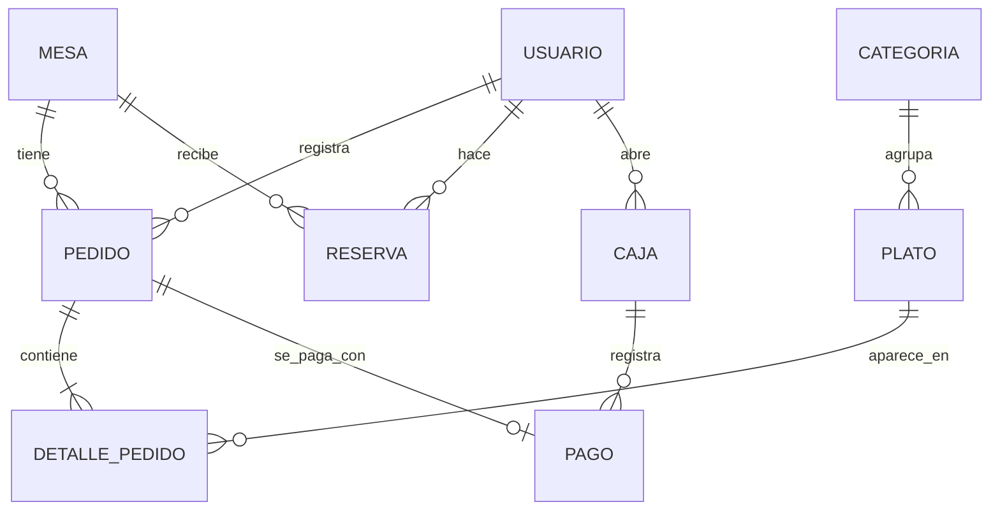

# Modelo de datos – SIGR v1.0.0

Las tablas se crean con las migraciones Flyway de `backend/src/main/resources/db/migration`.

| Migración | Contenido |
|---|---|
| V1__usuarios.sql | Tabla `usuario` |
| V2__menu.sql | Tablas `categoria` y `plato` + datos semilla del menú |
| V3__mesas_pedidos.sql | Tablas `mesa`, `pedido`, `detalle_pedido` + 8 mesas |
| V4__reservas.sql | Tabla `reserva` |
| V5__caja_pagos.sql | Tablas `caja` y `pago` |

| Tabla | Campos principales | Relaciones |
|---|---|---|
| usuario | id, nombre, email, password_hash, rol, activo | — |
| categoria | id, nombre, descripcion | 1:N plato |
| plato | id, categoria_id, nombre, precio, disponible, imagen_url | N:1 categoria |
| mesa | id, numero, capacidad, estado | 1:N pedido, 1:N reserva |
| pedido | id, mesa_id, mesero_id, estado, total, nota, creado_en | N:1 mesa, N:1 usuario |
| detalle_pedido | id, pedido_id, plato_id, cantidad, precio_unitario | N:1 pedido, N:1 plato |
| reserva | id, cliente_id, mesa_id, fecha, hora, personas, estado | N:1 usuario, N:1 mesa |
| caja | id, fecha, monto_apertura, monto_cierre, usuario_id, estado | N:1 usuario |
| pago | id, pedido_id (único), caja_id, medio_pago, valor | 1:1 pedido, N:1 caja |

## Reglas de negocio
- Estados del pedido: RECIBIDO → EN_PREPARACION → LISTO → ENTREGADO → PAGADO (PAGADO solo desde caja). Se puede cancelar en RECIBIDO o EN_PREPARACION.
- El precio del plato se congela en `detalle_pedido.precio_unitario`.
- Una reserva bloquea la mesa 120 minutos; horario de reservas 11:00–21:00.
- Solo puede existir una caja ABIERTA. Al cerrar: `monto_cierre = monto_apertura + pagos en efectivo`.
- Cambios al esquema: siempre con una nueva migración `V<n>__descripcion.sql`; nunca se editan migraciones aplicadas.
