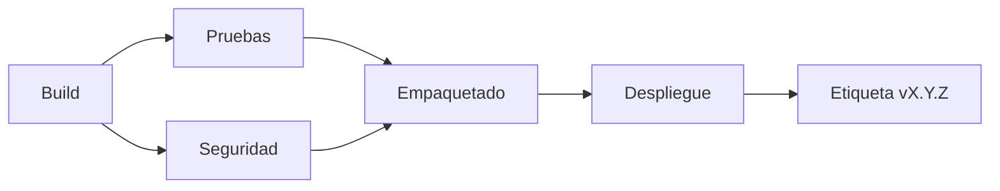

# Pipeline CI/CD – SIGR

Pipeline de integración y entrega continua en **GitHub Actions** para SIGR. Cada cambio pasa por
compilación, pruebas, análisis de seguridad, empaquetado en imágenes Docker y despliegue
**blue-green** con reversión automática.

## 1. Arquitectura del pipeline



| Archivo | Tipo | Responsabilidad |
|---|---|---|
| `.github/workflows/ci-cd.yml` | Orquestador | Disparadores, concurrencia, permisos y orden de las etapas; etiqueta de versión |
| `.github/workflows/build.yml` | Reutilizable | Compila backend y frontend |
| `.github/workflows/test.yml` | Reutilizable | Pruebas, cobertura y SonarCloud |
| `.github/workflows/security.yml` | Reutilizable | Gitleaks y Trivy sobre el código |
| `.github/workflows/package.yml` | Reutilizable | Imágenes Docker, escaneo y publicación en GHCR |
| `.github/workflows/deploy.yml` | Reutilizable | Despliegue blue-green, pruebas posteriores y reversión |
| `scripts/*.sh` | Bash | Lógica de despliegue (también se pueden correr a mano) |
| `tests/load/hora-pico.js` | k6 | Prueba de carga de hora pico |

### Etapas y herramientas

| Etapa | Herramientas | Qué hace | Bloquea si… |
|---|---|---|---|
| Build | Maven 3 + Temurin 17, Node 20 + npm, ESLint, Vite | `mvn -B -DskipTests package`; `npm ci`, `npm run lint`, `npm run build`. Publica el jar y el `dist/` como artefactos | No compila o ESLint reporta errores |
| Pruebas | JUnit 5, Spring Boot Test, H2 + Flyway, JaCoCo, Vitest, SonarCloud (opcional) | `mvn -B verify` (unitarias + integración + cobertura), resumen en la ejecución, `npm test`; análisis SonarCloud con *quality gate* | Falla una prueba o no se cumple el *quality gate* |
| Seguridad | Gitleaks, Trivy (fs) | Busca secretos en el historial; reporta vulnerabilidades CRITICAL/HIGH/MEDIUM de `pom.xml` y `package-lock.json` | Hay un secreto o una vulnerabilidad CRITICAL con arreglo disponible |
| Empaquetado | Docker Buildx, Trivy (image), GHCR | Construye `sigr-backend` y `sigr-frontend` con la etiqueta del SHA, las escanea y las publica | La imagen tiene una vulnerabilidad CRITICAL con arreglo |
| Despliegue | Docker, curl, k6, OWASP ZAP | Blue-green: versión nueva en el color inactivo → smoke test → (staging: carga + ZAP) → cambio de tráfico → smoke test público | Cualquier verificación falla → **rollback** automático |
| Etiqueta | git | Crea `vX.Y.Z` (versión de `backend/pom.xml`) tras desplegar en producción; si ya existe, no falla | — |

Las vulnerabilidades sin arreglo publicado (`ignore-unfixed`) y las excepciones justificadas de
`.trivyignore` (con fecha de vencimiento) no bloquean.

### Ramas y entornos

| Rama / evento | Entorno | Etapas | Aprobación |
|---|---|---|---|
| PR desde `feature/*` o `hotfix/*` | — | Build, Pruebas, Seguridad | No (sin despliegue) |
| push a `develop` | `desarrollo` | Todas + despliegue automático | No |
| push a `release` | `staging` | Todas + despliegue + **k6** + **ZAP** | No |
| push a `main` | `produccion` | Todas + despliegue + etiqueta de versión | **Sí**, revisor del entorno |

Puertos en el servidor de despliegue (runner):

| Entorno | Público (frontend) | Blue (backend) | Green (backend) | Estado |
|---|---|---|---|---|
| desarrollo | 8080 | 8081 | 8082 | `~/.sigr/desarrollo/` |
| staging | 9080 | 9081 | 9082 | `~/.sigr/staging/` |
| produccion | 10080 | 10081 | 10082 | `~/.sigr/produccion/` |

### Despliegue blue-green

Cada entorno tiene dos redes Docker:

- **datos** (`sigr-<entorno>-datos`): backend ↔ PostgreSQL 15 (alias `db`, volumen persistente).
- **front** (`sigr-<entorno>-front`): frontend (nginx) ↔ backend activo, que tiene el alias `backend`.

1. `deploy.sh` levanta la BD si no existe y arranca la versión nueva en el color **inactivo**,
   solo en la red de datos. El tráfico sigue en el color activo.
2. `smoke-test.sh` verifica salud, menú y login directamente contra el puerto del color nuevo.
3. En staging: `load-test.sh` (k6) y `zap-scan.sh` (ZAP) contra el color nuevo.
4. `switch-traffic.sh` conecta el color nuevo a la red front con alias `backend`, recrea el
   frontend con la imagen del mismo commit y detiene (sin borrar) el color anterior. nginx
   resuelve `backend` cada 5 s (`resolver 127.0.0.11` en `frontend/nginx.conf`), así que el
   cambio no requiere reiniciarlo.
5. `smoke-test.sh` verifica la URL pública (a través de nginx).
6. Si algo falla (o la ejecución se cancela), `rollback.sh` guarda los logs de la versión
   fallida, devuelve el tráfico al color anterior si ya se había cambiado y borra el contenedor nuevo.

> **Runner de despliegue.** Por defecto el despliegue corre en un runner efímero de GitHub
> (`ubuntu-latest`): todo el flujo se ejecuta y deja evidencias, pero los contenedores
> desaparecen al terminar el job. Para un entorno persistente, registre un *self-hosted runner*
> Linux con Docker y defina la variable de repositorio `DEPLOY_RUNNER=self-hosted`.

## 2. Configuración en GitHub (paso a paso)

### 2.1 Permisos de Actions
*Settings → Actions → General*:
1. **Actions permissions**: *Allow all actions and reusable workflows*.
2. **Workflow permissions**: *Read and write permissions* (necesario para publicar en GHCR y crear la etiqueta; cada job igual declara solo los permisos que usa).
3. Guardar.

### 2.2 Crear la rama `release`
```bash
git checkout develop && git pull
git checkout -b release
git push -u origin release
```

### 2.3 Entornos y secretos
*Settings → Environments → New environment*, crear `desarrollo`, `staging` y `produccion`.

En **produccion**:
- *Required reviewers*: agregarse a sí mismo (o al docente/revisor). Desmarcar *Prevent self-review* si el revisor es el mismo autor.
- *Deployment branches and tags*: *Selected branches* → `main`.

En `staging` restringir a `release` y en `desarrollo` a `develop` (opcional, recomendado).

Secretos de cada entorno (*Environment secrets*). Si faltan, los scripts usan valores de prueba:

| Secreto | Uso | Valor por defecto si falta |
|---|---|---|
| `DB_PASSWORD` | Contraseña de PostgreSQL | `sigr-<entorno>-pruebas` |
| `JWT_SECRET` | Firma de los tokens (32+ caracteres) | Se genera uno aleatorio con `openssl` y se guarda en `~/.sigr/<entorno>/jwt_secret` |
| `SIGR_ADMIN_PASSWORD` | Contraseña del administrador inicial | `Admin123*` |

Variables opcionales (*Settings → Secrets and variables → Actions → Variables*):
`DEPLOY_RUNNER` (p. ej. `self-hosted`), `SIGR_ADMIN_EMAIL`, `SONAR_ORGANIZATION`, `SONAR_PROJECT_KEY`.

> La contraseña de PostgreSQL se fija la primera vez que se crea el volumen. Si cambia el
> secreto después, borre el volumen `sigr-<entorno>-pgdata` (pierde los datos) o cambie la clave dentro de la BD.

> En repositorios **privados** de cuentas gratuitas, los *required reviewers* no están
> disponibles; el repositorio debe ser público (o tener GitHub Pro/Team).

### 2.4 Protección de ramas (ruleset)
*Settings → Rules → Rulesets → New branch ruleset*:
1. Nombre: `ramas-protegidas`; *Enforcement status*: **Active**.
2. *Target branches*: `main`, `release` y `develop` (*Include by pattern*).
3. Reglas:
   - *Restrict deletions* y *Block force pushes*.
   - *Require a pull request before merging* (1 aprobación en `main`; en un proyecto individual puede dejarse en 0).
   - *Require status checks to pass*: agregar los checks del pipeline (aparecen después de la primera ejecución), por ejemplo
     `Build / Backend (Maven)`, `Build / Frontend (Vite)`, `Pruebas / Backend (mvn verify)`,
     `Pruebas / Frontend (Vitest)`, `Seguridad / Secretos (Gitleaks)`, `Seguridad / Dependencias (Trivy fs)`.
4. Guardar.

### 2.5 SonarCloud (opcional)
1. Entrar a https://sonarcloud.io con GitHub e importar el repositorio.
2. *Administration → Analysis Method*: **desactivar Automatic Analysis** (el análisis lo hace el pipeline).
3. *My Account → Security*: generar un token.
4. En GitHub: secreto de repositorio `SONAR_TOKEN` y variables `SONAR_ORGANIZATION` (clave de la organización) y `SONAR_PROJECT_KEY` (p. ej. `Jhonii10_sigr`).

Sin `SONAR_TOKEN` el paso se omite y el pipeline sigue.

### 2.6 Paquetes de GHCR
Las imágenes se publican en `ghcr.io/<owner>/sigr-backend` y `sigr-frontend` y quedan enlazadas
al repositorio. Se ven en la pestaña **Packages** del perfil.

## 3. Recorrido del flujo completo

1. **Feature**: `git checkout develop && git checkout -b feature/EC-xx-descripcion`, commit y push.
   Abrir un PR hacia `develop` → corren Build, Pruebas y Seguridad (sin despliegue).
2. **Desarrollo**: fusionar el PR → push a `develop` → se empaqueta y se despliega en `desarrollo`.
3. **Staging**: PR `develop → release` y fusionar → despliegue en `staging` con prueba de carga k6 y escaneo ZAP.
4. **Producción**: PR `release → main` y fusionar → el job *Despliegue* queda en **Waiting**.
   En la ejecución, *Review deployments* → marcar `produccion` → *Approve and deploy*.
5. Al terminar, el job *Etiqueta de versión* crea `v1.0.0` (o la versión de `backend/pom.xml`).
   Para una nueva entrega, suba la versión en `pom.xml` (y el nombre del jar en `backend/Dockerfile`) y actualice el CHANGELOG.

También se puede lanzar a mano: *Actions → CI/CD → Run workflow* (elige la rama).

## 4. Simulación de fallos (para el informe)

Hacer cada prueba en una rama `feature/` aparte y abrir un PR (los fallos 1–4 se ven en el PR;
el 5 necesita llegar a una rama con despliegue, por ejemplo con un push a `develop`).
Revertir el cambio al terminar.

| # | Fallo | Cómo provocarlo | Qué debe pasar |
|---|---|---|---|
| 1 | Prueba unitaria que falla | En `backend/src/test/java/co/sigr/pedidos/EstadoPedidoTest.java` cambiar una aserción (p. ej. `isTrue()` por `isFalse()`) | *Pruebas / Backend* en rojo; el resumen muestra 1 fallida; no hay empaquetado ni despliegue |
| 2 | Regresión de negocio: solapamiento de reservas | En `ReservaService.haySolapamiento` reemplazar el cuerpo por `return false;` | Fallan `ReservaServiceTest.detectaSolapamientoDentroDeLaFranja`, `rechazaReservaSinMesasDisponibles` y la integración `reservaYValidacionDeSolapamiento` |
| 3 | Dependencia vulnerable | En `backend/pom.xml` agregar `<dependency><groupId>org.apache.logging.log4j</groupId><artifactId>log4j-core</artifactId><version>2.14.1</version></dependency>` | *Seguridad / Trivy fs* en rojo por CVE-2021-44228 (Log4Shell, CRITICAL) |
| 4 | Secreto expuesto | Crear `config/credenciales.txt` con una clave con formato real, p. ej. `aws_access_key_id = AKIA` seguido de 16 letras mayúsculas o números | *Seguridad / Gitleaks* en rojo (regla `aws-access-token`). Después de revertir, el commit sigue en el historial: use una rama que luego se borre sin fusionar |
| 5 | Despliegue fallido → reversión | En `scripts/deploy.sh` cambiar `DB_URL="jdbc:postgresql://db:5432/${DB_NAME}"` por `DB_URL="jdbc:postgresql://db-inexistente:5432/${DB_NAME}"` y hacer push a `develop` | El backend nuevo no arranca, *Smoke test de la versión nueva* falla, corre *Reversión (rollback)*: muestra los logs y borra el contenedor; el color activo sigue atendiendo |

## 5. Evidencias

| Evidencia | Dónde tomarla |
|---|---|
| Diagrama y orden de las etapas | *Actions → CI/CD → (ejecución)*: grafo de jobs |
| Resultado de compilación | Job *Build*; artefactos `sigr-backend-jar` y `sigr-frontend-dist` |
| Resumen de pruebas y cobertura | Resumen (*Summary*) de la ejecución: tabla "Pruebas backend" |
| Reportes JUnit/JaCoCo | Artefacto `reportes-pruebas-backend` (abrir `jacoco/index.html`) |
| Calidad de código | Panel de SonarCloud (*quality gate*, cobertura, *code smells*) |
| Secretos | Log del job *Seguridad / Secretos (Gitleaks)* |
| Vulnerabilidades | Resumen "Trivy fs" y artefacto `trivy-fs-reporte`; log de *Escanear imagen con Trivy* |
| Imágenes publicadas | Perfil → *Packages* → `sigr-backend` / `sigr-frontend` (etiqueta = SHA) |
| Aprobación manual | Ejecución en `main`: banner *Review deployments* y el historial en *Deployments* del repositorio |
| Despliegue blue-green | Artefacto `evidencias-<entorno>-<n>`: `despliegue-<entorno>.txt`, `smoke-nueva.txt`, `smoke-publica.txt` |
| Prueba de carga | Artefacto de staging: `k6-resumen.txt` (p95, errores, umbrales) y `k6-resumen.json` |
| Escaneo dinámico | Artefacto de staging: `zap-reporte.html` |
| Reversión | Log del paso *Reversión (rollback)*; `rollback.txt` y `rollback-logs-<color>.txt` en el artefacto de evidencias |
| Versión etiquetada | *Code → Tags* (`v1.0.0`) |
| Dependabot | Pestaña *Pull requests* (PR `chore(deps)` hacia `develop`) |

## 6. Ejecución manual de los scripts

En un Linux con Docker, desde la raíz del repo:

```bash
export ENTORNO=desarrollo IMAGE_TAG=local REGISTRY=sigr
docker build -t sigr/sigr-backend:local backend
docker build -t sigr/sigr-frontend:local frontend
bash scripts/deploy.sh
bash scripts/smoke-test.sh "http://localhost:$NEXT_PORT/api" nueva
bash scripts/switch-traffic.sh
bash scripts/smoke-test.sh "http://localhost:$PUBLIC_PORT/api" publica
# bash scripts/rollback.sh   # para revertir
```

Para borrar un entorno: `docker rm -f $(docker ps -aq --filter label=sigr.entorno=desarrollo)`,
`docker network rm sigr-desarrollo-datos sigr-desarrollo-front`, `docker volume rm sigr-desarrollo-pgdata sigr-desarrollo-imagenes`
y `rm -rf ~/.sigr/desarrollo`.
